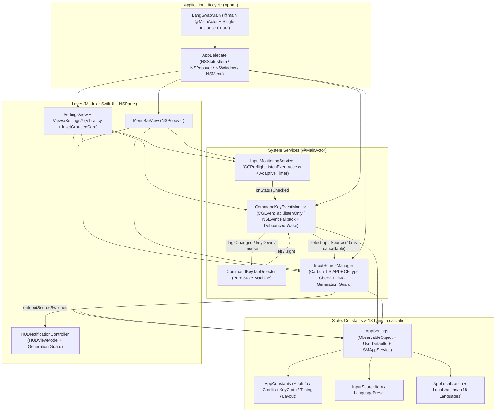
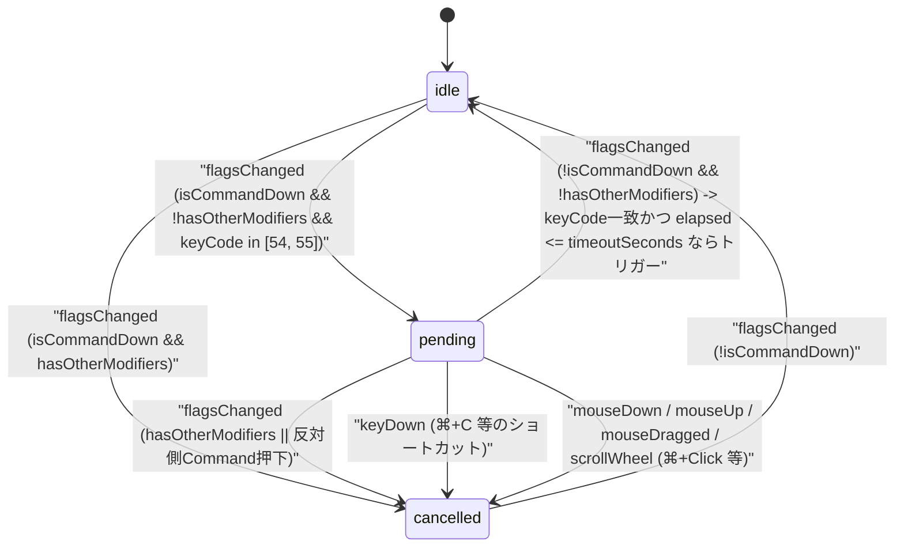

# 開発者向け技術仕様書 — LangSwap for Mac US Keyboard

本書は、**LangSwap (`v1.0.0`)** のコードベースに基づくシステムアーキテクチャ、モジュール責務、キーイベント判定アルゴリズム、Carbon 入力ソース制御、外観管理、永続化仕様、および配布ビルド／DMG パッケージングパイプラインをまとめた技術仕様書です。

---

## 1. システム全体アーキテクチャ

LangSwap は **Pure AppKit エントリポイント + `@MainActor` シングルトンサービス群 + モジュール化された SwiftUI ビュー層** で構成される単一プロセス・アクセサリ型（`LSUIElement = true`）Apple Silicon (`arm64`) ネイティブ（`--universal` で Universal Binary 対応）macOS アプリケーションです。

---

## 2. ディレクトリ・ファイル構成と責務一覧

| パス | 行数 | 主な公開型 | 責務 |
| --- | ---: | --- | --- |
| `Package.swift` | 33 | `Package` | Swift 5.9 (`macOS(.v13)`) パッケージ定義。ターゲット `LangSwap`（パス `Sources/LangSwap`）、テストターゲット `LangSwapTests`（`Tests/LangSwapTests`）、`Carbon`, `AppKit`, `SwiftUI`, `CoreGraphics`, `ServiceManagement` リンク |
| `Info.plist` | 63 | — | バンドル設定（`com.studionovaworks.LangSwap`, `CFBundleDevelopmentRegion = en`, `CFBundleLocalizations` 18 言語宣言, `CFBundleShortVersionString = 1.0.0`, `CFBundleVersion = 1`, `LSApplicationCategoryType = public.app-category.utilities`, `LSMinimumSystemVersion = 13.0`, `LSUIElement = true`, `NSSupportsAutomaticTermination/SuddenTermination = false`, `AppIcon`, `NSHumanReadableCopyright`） |
| `build_app.sh` | 86 | — | Apple Silicon (`arm64`) ネイティブ（`--universal` 指定時は `arm64 + x86_64`）Release ビルド、`lipo` 検証、`strip -x`、`Resources/AppIcon.icns` 同梱、`dist/LangSwap.app` パッケージング、`Developer ID Application` SHA-1 ハッシュ限定＋`--options runtime --timestamp`（未設定時は Ad-hoc）署名・厳格検証 |
| `scripts/generate_dmg_background.swift` | 535 | `Options`, `DMGLayout` | CoreGraphics / AppKit + `ImageIO` DPI + `tiffutil -cathidpicheck` により、`AppIcon.png` と平行な 12° 斜め分割・ベクター矢印・12.5pt 均等文字サイズの日英 2 ステップ案内を備えた `600×400pt` (`@1x/@2x`) Retina DMG 背景 TIFF および Finder プレビュー PNG を生成 |
| `scripts/package_dmg.sh` | 215 | — | Retina 背景画像（`dmg_background.tiff`、`Info.plist` 等との mtime 比較）自動生成、HFS+ `UDRW` ステージング、Finder `osascript` ウインドウ・アイコン配置適用（`--no-finder-layout` でスキップ可能）、`.VolumeIcon.icns`（`SetFile -a C`）付与、`hdiutil convert -format UDZO` 圧縮、`--timestamp` 署名・`hdiutil verify`・SHA-256 出力を実施（`--build` / `--universal` 対応） |
| `Sources/LangSwap/LangSwapApp.swift` | 376 | `LangSwapMain`, `AppDelegate` | `@MainActor` エントリ・単一インスタンス起動ガード（多重起動時は `DistributedNotificationCenter` で既存インスタンスの設定画面を再表示）、`--self-test` 分岐、`NSApplication` (`.accessory`) 起動、`disableAutomaticTermination`、UI 言語連動 `NSMenu`、外観同期、ログイン項目状態再同期、`NSStatusItem` & `NSPopover`（`preferredContentSize` 自動追従）、単一 `NSWindow`（`sizingOptions = []` ＋ `720 × 590` 固定）、終了時 `shutdown()` 解放、PID 待機型 `relaunchApplication()` |
| `Sources/LangSwap/Models/AppConstants.swift` | 68 | `AppConstants` | `AppInfo`（名称・フォールバックバージョン・多重起動通知名）、`Credits`（Studio Nova Works / 2026）、`KeyCode`、`Timing`（監視ポーリング・デバウンス・タップ無効化バックオフ設定）、`Layout` 定数管理 |
| `Sources/LangSwap/Models/AppSettings.swift` | 384 | `AppSettings` | `LangSwap.*` 全 10 キーの `@Published` + `UserDefaults` 永続化、`Locale.preferredLanguages` 連動の初回左右自動割り当て（初期プリセット空）、重複排除・先頭移動・削除、`SMAppService` 登録（`loginItemStatusProvider` DI 対応）・承認待ち/エラー状態追跡・`openLoginItemsSettings()`、ウィンドウ単位 AppKit テーマ適用 |
| `Sources/LangSwap/Models/InputSourceItem.swift` | 231 | `InputSourceItem`, `LanguagePreset` | `TISInputSource` 抽象モデル、Kotoeri/Google Roman 半角英字モード判別（`isJapaneseRomanOrAlphanumericMode` / 全角英数 `FullWidthRoman` 除外）、`isASCIICapable` 保護属性、`badgeCode`、絵文字なし表示名（`cleanTitle` / `cleanShortName`）、ロケール対応補助言語名 |
| `Sources/LangSwap/Models/AppLocalization.swift` | 309 | `AppTheme`, `AppLanguage`, `L10nKey`, `L10n` | `AppTheme.nsAppearance` による AppKit 外観定義、18 言語定義（全 103 キー、`pt` は `pt_BR`）、プライバシーポリシー URL（`?lang=` 付帯）ヘルパー、端末ロケール自動判定（`detectDefault` + `.en` フォールバック）、RTL 判定、翻訳テーブル統合・完全網羅検証（`hasCompleteCoverage`） |
| `Sources/LangSwap/Models/Localizations/Translations_Core.swift` | 531 | — | `en`, `ja`, `zh_CN`, `zh_TW`, `ko` 翻訳辞書 |
| `Sources/LangSwap/Models/Localizations/Translations_Europe.swift` | 846 | — | `fr`, `it`, `de`, `es`, `pt`, `tr`, `uk`, `ru` 翻訳辞書 |
| `Sources/LangSwap/Models/Localizations/Translations_AsiaME.swift` | 531 | — | `ar`, `hi`, `th`, `id`, `vi` 翻訳辞書 |
| `Sources/LangSwap/Services/CommandKeyEventMonitor.swift` | 493 | `CommandKeyEventMonitor` | `CGEventTap` 監視（`CGPreflightListenEventAccess` ガード・`CapturedCGEvent` Swift 6 安全変換・`.listenOnly`、`mouseUp` 含むマウス監視）、同期安全 `NSEvent` フォールバック、権限昇格／剥奪一本化、0.25s デバウンス復帰（世代重複抑止）、5 秒内 3 回超のタップ無効化でフォールバック降格する非同期バックオフ、終了時 `shutdown()` 解放、キャンセル可能 10ms 切り替え発火 |
| `Sources/LangSwap/Services/CommandKeyTapDetector.swift` | 133 | `CommandKeySide`, `CommandKeyTapDetector` | 左右 Command キー単押し判定の純粋ステートマシン（`Fn` 含む修飾キー除外） |
| `Sources/LangSwap/Services/InputSourceManager.swift` | 518 | `InputSourceManager` | Carbon `TIS*` API ラッパー、`CFGetTypeID` 安全検証、HIToolbox キャッシュ汚染対策（親 `TISTypeKeyboardInputMethodModeEnabled` 照合）、親メソッド先行有効化＋未選択兄弟 `InputMode` 連動クリーンアップ、安全削除 `disableInputSource`（最後・唯一 ASCII 保護／アクティブソース退避／親 IME 連動無効化／割り当てクリア）、未追加ソースメタデータキャッシュ（`metadataCache`）、`selectGeneration` 世代ガード付き CJKV 20ms リトライ、終了時 `shutdown()` 解放 |
| `Sources/LangSwap/Services/InputMonitoringService.swift` | 106 | `InputMonitoringService` | 入力監視（`CGPreflightListenEventAccess` / `CGRequestListenEventAccess`）一元チェック（`@Published isTrusted` 変化時のみ更新）、省電力適応タイマー（未許可 2 秒／許可済み 30 秒）、`Privacy_ListenEvent` 設定ペイン直接遷移、終了時 `shutdown()` 解放 |
| `Sources/LangSwap/Services/SelfTestRunner.swift` | 323 | `SelfTestRunner` | `--self-test` フラグ実行の内蔵テストランナー（全 56 項目） |
| `Sources/LangSwap/Views/SettingsView.swift` | 252 | `SettingsView` | 2 ペイン設定コンテナ（実効監視状態連動、Vibrancy/Divider、右寄せトグル付きヘッダーバー、アラビア語 RTL 時上余白調整、権限警告バナー） |
| `Sources/LangSwap/Views/Settings/SettingsModels.swift` | 68 | `SettingsTab`, `SettingsUIState` | 4 タブ定義およびキャンセル可能なプレビューハイライト状態管理 |
| `Sources/LangSwap/Views/Settings/SettingsSharedComponents.swift` | 287 | `AppIconBadgeView`, `LangCodeBadge`, `LoginItemStatusHintView` 他 | `VisualEffectBackground`, `InsetGroupedCard`, `AppIconBadgeView`, `PermissionBannerView`, `LoginItemStatusHintView`, `InputSourcePickerHelper`（未追加入力ソース判定・ラベル整形含む） |
| `Sources/LangSwap/Views/Settings/SettingsSidebarView.swift` | 65 | — | Vibrancy サイドバー（バンドルアイコンバッジ + `LangSwap` + 4 タブナビゲーション） |
| `Sources/LangSwap/Views/Settings/KeyMappingTabView.swift` | 347 | — | コンパクトキープレビュー（RTL 時も LTR 物理配置固定）、左右言語 Picker（柔軟ラベル幅＋未追加警告）、プリセットチップ（未追加警告付き）、起動設定トグル＋ログイン項目承認ヒント、右下 **「LangSwap を終了」** ボタン |
| `Sources/LangSwap/Views/Settings/PresetsLanguagesTabView.swift` | 211 | — | 保存済みプリセット管理（言語追従表示・未追加バッジ・適用・削除）、`LazyVStack` による全インストール済み入力ソース検索・有効化・「追加済み」横の安全削除（ゴミ箱ボタン） |
| `Sources/LangSwap/Views/Settings/BehaviorTabView.swift` | 176 | — | 自動起動（承認ヒント付き）、バックグラウンド起動、外観（`minWidth: 220, maxWidth: 295` セグメント）・言語、切り替え通知、単押し判定スライダー、アクセス権限カード |
| `Sources/LangSwap/Views/Settings/GuideTabView.swift` | 228 | — | 最上段 Ko-fi 開発支援＋Studio Nova Works クレジットカード、アプリ概要（`v1.0.0` ＋ プライバシーポリシーリンク）、使い方手順（4項目）、よくあるトラブル（6項目 Q&A） |
| `Sources/LangSwap/Views/MenuBarView.swift` | 240 | `MenuBarView` | ステータスバークリック時の `NSPopover` クイック設定画面（2 行折返し許可バナー・未追加入力ソース警告・スクロール対応プリセット一覧・非フォーカス安全なフッター操作・`AppIconBadgeView`） |
| `Sources/LangSwap/Views/HUDNotificationWindow.swift` | 167 | `HUDNotificationController` | `HUDViewModel` 再利用＋世代トークンガード＋フレーム再計測付き非アクティブ `NSPanel` 切り替え通知 HUD（固定ダークガラス仕様） |
| `Tests/LangSwapTests/CommandKeyLogicTests.swift` | 425 | `CommandKeyLogicTests` | XCTest 単体テストスイート（`SelfTestRunner` と網羅項目を同期） |
| `Resources/AppIcon.icns` / `AppIcon.png` | — | — | アプリアイコンアセット（`.icns` は `dist/LangSwap.app/Contents/Resources/` 同梱および DMG `.VolumeIcon.icns` に使用） |
| `Resources/dmg_background.tiff` | — | — | スプリット・シグネチャー構図の `600×400pt` (`@1x` 72 DPI + `@2x` 144 DPI) マルチ解像度 DMG 背景画像 |
| `docs/LangSwap_PrivacyPolicy.html` | 1730 | — | GitHub Pages 公開用の単一ファイル 18 言語（アラビア語 RTL 含む）・ライト/ダーク自動追従プライバシーポリシー HTML |
| `docs/ARCHITECTURE.md` / `CODE_REVIEW.md` | — | — | 技術仕様書・リリースレビュー報告書 |

---

## 3. キーイベント監視と単押し判定の仕組み

### 3.1 イベント監視アーキテクチャ（`CommandKeyEventMonitor`）

`CommandKeyEventMonitor.shared` は `@MainActor` シングルトン（`private init()` / 終了時 `shutdown()` 解放）として動作し、2 系統の監視とシステムライフサイクル復旧を備えています。

1. **プライマリ経路: CoreGraphics Event Tap (`setupCGEventTap`)**
   - 最小権限方針: 他アプリへのキー送出や入力改変を行わないため、アクセシビリティ権限（`kTCCServiceAccessibility` / `.defaultTap`）は使用せず、**入力監視（`kTCCServiceListenEvent`）＋ 読み取り専用タップ `.listenOnly`** のみに統一しています。
   - サイレント遮断防止ガード: macOS では `kTCCServiceListenEvent` が未許可または古い Ad-hoc `cdhash` 状態のときに `CGEvent.tapCreate(..., options: .listenOnly, ...)` 自体は非 `nil` を返しつつ他アプリのイベントだけを遮断する（最前面時のみ動く）現象が起きるため、`setupCGEventTap()` 冒頭で必ず `guard CGPreflightListenEventAccess() else { return false }` を検証してから `CGEvent.tapCreate(..., options: .listenOnly, ...)` を生成します（すべてのパスで `Unmanaged.passUnretained(event)` を返却し入力を改変・遮断しません）。
   - Swift 6 並行性安全 (`CapturedCGEvent`): C コールバック内で非 `Sendable` な `CGEvent` を直接 `@MainActor` クロージャへ渡さず、`Sendable` 値型の `CapturedCGEvent` へ同期変換してから `runOnMain`（メインスレッド時は `MainActor.assumeIsolated`）経由で処理します。
   - 監視対象マスク: `flagsChanged`, `keyDown`, `leftMouseDown`, `leftMouseUp`, `rightMouseDown`, `rightMouseUp`, `otherMouseDown`, `otherMouseUp`, `leftMouseDragged`, `rightMouseDragged`, `scrollWheel`（ドラッグ＆ドロップ解放時も抑止）。
   - 停止・解放時（`stopMonitoring()` / `shutdown()`）には、`CFRunLoopRemoveSource` に加えて `CFRunLoopSourceInvalidate` と `CFMachPortInvalidate` を確実に実行します。
   - タイムアウト／剥奪復旧: `.tapDisabledByTimeout` / `.tapDisabledByUserInput` 受信時は `detector.reset()` に加え、`.tapDisabledByUserInput` 時は `InputMonitoringService.shared.checkPermission(prompt: false)` を即時実行して権限状態を同期します。続いて `CGEvent.tapEnable(tap: tap, enable: true)` を試し、`CGEvent.tapIsEnabled(tap: tap)` が `false` のままなら `DispatchQueue.main.async` 経由で非同期復旧します（`5.0 秒` 以内に `3 回` を超えて連続無効化された場合はループを避けて安全な `NSEvent` フォールバック監視へ降格し、正常イベント受信時にカウンタをリセットします）。

2. **フォールバック経路: AppKit `NSEvent` モニタ (`setupNSEventFallbackMonitors`)**
   - `CGPreflightListenEventAccess()` 未許可または `CGEvent.tapCreate` 失敗時は `NSEvent.addGlobalMonitorForEvents` / `addLocalMonitorForEvents` にフォールバックします（UI 上では `isEffectivelyTrusted = false` として入力監視の許可バナーを表示）。イベント順序逆転を防ぐため、メインスレッド配信時は `MainActor.assumeIsolated` で同期処理します。

3. **権限連動とスリープ・ロック解除復旧**
   - `InputMonitoringService` は `CGPreflightListenEventAccess()`（確認）および `CGRequestListenEventAccess()`（許可要求・システム設定ペイン `Privacy_ListenEvent` 遷移）を一元管理し、`isTrusted` は値が変化したときのみ `@Published` 更新を行います。権限未許可時は **2.0 秒間隔（tolerance 0.3s）**、許可済み時は **30.0 秒間隔（tolerance 5.0s）** の省電力ポーリングに加え、`NSApplication.didBecomeActiveNotification` と `NSWorkspace.didWakeNotification` で即時再確認します。
   - `onStatusChecked` 一本化により、権限昇格時（`trusted == true`）だけでなく、実行中の権限剥奪時（`trusted == false && isUsingCGEventTap`）にも `detector.reset()` ＋ `restartMonitoring()` を重複なく駆動して安全にフォールバック降格します。
   - さらに `NSWorkspace.didWakeNotification`・`screensDidWakeNotification`・`"com.apple.screenIsUnlocked"` を監視し、`0.25 秒` のデバウンス後に世代番号（`monitoringRestartGeneration`）で `onStatusChecked` 側との二重再起動を回避しつつ、停止状態からの復帰も含めて再起動を 1 回だけ実行します。

### 3.2 単押し判定ステートマシン（`CommandKeyTapDetector`）

- 対象キーコード: `AppConstants.KeyCode.leftCommand` (`55`) / `rightCommand` (`54`)。
- 他修飾キー判定（`hasOtherModifiers`）:
  - CoreGraphics 側: `.maskShift`, `.maskControl`, `.maskAlternate`, `.maskSecondaryFn`, `.maskHelp`（`CapsLock` は除外）
  - NSEvent 側: `[.shift, .control, .option, .function, .help]`

- **キャンセル可能な遅延切り替え**: `triggerLanguageSwitch(for:)` は `switchWorkItem`（`DispatchWorkItem`）を保持して `0.01 秒` 後に実行し、新規トリガーまたは `stopMonitoring()` 時には未実行の先行タスクをキャンセルします。

---

## 4. 入力ソース（言語）切り替えと動的取得の仕組み

`InputSourceManager.shared`（`@MainActor`、`private init()` / 終了時 `shutdown()` にて通知解除）が Carbon HIToolbox の **Text Input Source (TIS) Services** を管理します。

1. **動的取得と実有効状態の照合（Carbon TIS 特性への対策）**:
   - `TISCreateInputSourceList` から `kTISCategoryKeyboardInputSource` かつ `kTISPropertyInputSourceIsSelectCapable = true` のうち、`kTISTypeKeyboardLayout` / `kTISTypeKeyboardInputMode` / `kTISTypeKeyboardInputMethodWithoutModes` のみを抽出します。
   - プロパティ読み取りヘルパー（`getStringProperty`, `getStringArrayProperty`, `getBoolProperty`）はすべて `CFGetTypeID` により `CFStringGetTypeID()` / `CFArrayGetTypeID()` / `CFBooleanGetTypeID()` を事前検証します（安全キャストのみを使用し強制キャストを行いません）。
   - macOS HIToolbox は `TISCreateInputSourceList(..., true)`（全インストール済み一覧）を同一プロセス内で 1 度でも呼び出すと、それ以降 `includeAllInstalled = false`（有効一覧）を呼び出した際にも未有効 IME（`TISTypeKeyboardInputMethodModeEnabled`）配下の既定 `InputMode` まで `isEnabled = true` として混入させるキャッシュ汚染挙動があるため、`parentMethodBundleStatus()` で親 IME バンドルごとの実有効集合を取得し、全取得・切替経路（`fetchInputSources` / `selectInputSource`）で `isActuallyEnabled` による照合・除外を実施します。`refreshInputSources()` 時は表示済みの `installableSources` も同時に再同期します。
   - ユーザーが「言語設定」タブから `TISTypeKeyboardInputMode` を有効化する際（`enableInputSource`）は、同一 `kTISPropertyBundleID` に紐づく親 `kTISTypeKeyboardInputMethodModeEnabled` が無効なら先に `TISEnableInputSource` で有効化したうえで対象モードを有効化し、新たに有効化した親 IME に付随して既定有効化されていた未選択の兄弟 `InputMode` は `TISDisableInputSource` で明示的に無効化します。逆に「追加済み」横のゴミ箱ボタンから削除する際（`disableInputSource`）は、`canDisable(sourceID:in:)` により最後の 1 件および唯一の `isASCIICapable` ソースを保護したうえで、使用中なら別ソースへ退避し、同一バンドル内に他の有効モードが残らない場合は子モードと親 IME（`parentStatus == noErr` を検証）の両方を `TISDisableInputSource` で無効化し、左右 Command 割り当ても `disabledID` へ安全にクリアします。また、`item(forID:)` は未有効入力ソース（プリセット含む）に対してもターゲット参照＋`metadataCache` により正確な表示名と `isEnabled: false` を返し、UI 全体（`InputSourcePickerHelper` 等）で「未追加」警告を明示します。
2. **CJKV InputMode 検証リトライ (`performSelect`) & 世代ガード**:
   - `selectInputSource` は現在有効な入力ソースのみを対象とし、ユーザーが無効化／削除した入力ソースを無断で `TISEnableInputSource` 再有効化しません。
   - `TISSelectInputSource` 成功後、`fetchCurrentInputSource()?.id == sourceID` で実際の反映を検証します。英字レイアウトから日本語・中国語・韓国語等の `InputMode` へ切り替える際に遅延／未反映が発生していた場合は、世代カウンタ（`selectGeneration`）でガードした `retryWorkItem`（`0.02 秒` 後・`MainActor.assumeIsolated` 直接実行）で 1 度だけ再選択と実状態確認を行い、確認後に `currentSource` 更新と通知 HUD を発火します。
3. **Kotoeri / Google 日本語入力等の英字モード判定 (`InputSourceItem`)**:
   - `isJapaneseRomanOrAlphanumericMode` が `fullwidth`（全角英数 `FullWidthRoman`）を除外したうえで `kotoeri` / `japanese` かつ `roman` / `alphanumeric` を判定し、半角英字モードのみを `badgeCode = "EN"`・`isEnglishLike = true`・`isJapaneseLike = false` に分類します。
   - 補助言語名は `AppLanguage.localeIdentifier` を用いた `Locale` で生成され、特定のロケール固定に依存しません。

---

## 5. 設定データの永続化方式

`AppSettings.shared` が `UserDefaults.standard`（テスト時は任意のスイートを注入）に以下の 10 キーを永続化します。

| UserDefaults キー | 型 | デフォルト値 | 用途 |
| --- | --- | --- | --- |
| `LangSwap.isEnabled` | `Bool` | `true` | Command 単押し切り替え機能の有効/停止 |
| `LangSwap.leftCommandSourceID` | `String` | `""`（初回自動判定） | 左 Command (`keyCode 55`) 割り当て ID |
| `LangSwap.rightCommandSourceID` | `String` | `""`（初回自動判定） | 右 Command (`keyCode 54`) 割り当て ID |
| `LangSwap.tapTimeoutMs` | `Int` | `400` (`150...1000`) | 単押し判定の最大押下時間（ミリ秒） |
| `LangSwap.showHUDNotification` | `Bool` | `true` | 切り替え時の画面下部通知表示有無 |
| `LangSwap.presets` | `Data` (JSON) | `[]`（初回空） | `[LanguagePreset]` の JSON 配列 |
| `LangSwap.hasInitializedDefaults` | `Bool` | `false` | 初回スマート初期設定完了フラグ |
| `LangSwap.launchInBackground` | `Bool` | `false` | 起動時に設定ウインドウを開かずメニューバー常駐にするか（明示オプトイン） |
| `LangSwap.appTheme` | `String` | `"system"` | `AppTheme.rawValue` (`system` / `light` / `dark`) |
| `LangSwap.appLanguage` | `String` | 端末ロケール自動判定 | `AppLanguage.rawValue`（18 言語、非対応時は `"en"`） |

- **ログイン時自動起動 (`launchAtLogin`)**: `ServiceManagement.SMAppService.mainApp` を直接参照・登録解除し、承認待ち（`.requiresApproval`）および登録エラー状態を `launchAtLoginNeedsApproval` / `launchAtLoginError` で追跡して設定 UI 下に案内＋システム設定「ログイン項目」遷移ボタン（`LoginItemStatusHintView`）を表示します。また設定ウインドウを開く際やアプリ前面化時に `refreshLaunchAtLoginStatus()` で OS 側のログイン項目変更と同期します。
- **ロケール連動の初回初期値・プリセット設計**: `applySmartDefaultsIfNeeded(availableSources:preferredLanguages:)` は左 ⌘ に英語系（`U.S.` / `ABC`）、右 ⌘ に `Locale.preferredLanguages` 上の主要非英語言語（日本語環境ならひらがな、ドイツ語環境ならドイツ語等）を自動割り当てますが、プリセット配列 `presets` は初回から自動登録せず空のまま開始します。UI 表示上は `InputSourcePickerHelper.presetDisplayName` によって現在の UI 言語に応じた `<左言語> ↔ <右言語>` が動的生成され、同一 `(left, right)` ペアの重複は排除されます。

---

## 6. UI・外観モード・18 言語ローカライズ・ビルド設計

1. **単一ウインドウ管理・単一インスタンス起動 (`AppDelegate` / `LangSwapMain`)**: `LangSwapMain` からの Pure AppKit 起動（`AutomaticTermination` 無効化＋`NSRunningApplication` 多重起動ガード［再起動要求時は `DistributedNotificationCenter` で既存インスタンスの設定画面を表示］＋PID 終了待機型 `relaunchApplication()`）と単一 `NSWindow`（`hostingController.sizingOptions = []` + `setContentSize(720 × 590)`, `isRestorable = false`）、メニューバーポップオーバー（`NSHostingController.sizingOptions = [.preferredContentSize]` で内容高へ自動追従）、言語設定変更に追従する `NSMenu`（`⌘,`, `⌘W`, `⌘M`, `⌘Q`, Edit 操作）で構成されます。`SettingsView` は親サイズへ全方向追従しつつ上端 Safe Area を解除し、アラビア語 RTL 時のみヘッダー上余白を拡大（`38pt`）して信号ボタンとの重なりを回避します。また `KeyMappingTabView` のハードウェアキー配列プレビューは `.environment(\.layoutDirection, .leftToRight)` で物理 US 配列（`[⌘L] [space] [⌘R]`）を固定維持します。
2. **AppKit ベースの外観モード制御 (`AppTheme.nsAppearance`)**: SwiftUI の `.preferredColorScheme(nil)` が `NSHostingController` 上で先行指定（`.light` 等）を上書き解除しきれない制約を回避し、かつメニューバーアイコンがライトモード時に黒潰れしないよう、`NSApp.appearance` は常に `nil` を維持したまま `settingsWindow` と `popover`（および通常ウインドウ）にのみ `AppTheme.nsAppearance` を適用します（`NSStatusBarWindow` と `HUDNotificationController` 用 `NSPanel` は対象外）。
3. **モジュール構成設定ビュー群 (`Views/Settings/`) & メニューバーアイコン**:
   - メニューバーアイコンはシンプルな白線アウトライン（SF Symbol `command`、停止時アルファ調整、`appearance = nil`）を採用し、OS メニューバーの背景色へ自動適応します。
   - `MenuBarView`（`NSPopover`）のプリセット一覧は最大高さ制限付き `ScrollView` を備え、2 行折返し許可バナー・未追加ソース警告表示と、背面アプリへの誤ショートカット送信を防ぐシンプルなクリック操作フッターを提供します。
   - `HUDNotificationController` は切り替え時に `invalidateIntrinsicContentSize()`＋次サイクル再計測で長名称入力ソース切り替え時の初回中央配置を安定させます。
   - `AppIconBadgeView` によりバンドル内 `Resources/AppIcon.icns` をサイドバー・ポップオーバーへ高品位レンダリングします。
   - `PresetsLanguagesTabView` は `LazyVStack` を採用し、システム内の全インストール済み入力ソースを件数上限なくスクロール表示します。
   - `KeyMappingTabView` 右下に誤操作防止区切り付きの終了ボタン（`NSApplication.shared.terminate(nil)`）、`BehaviorTabView` 最下部に常時「設定を確認／システム設定を開く」遷移ボタン付きの平易なアクセス権限カード、`GuideTabView` には **開発を支援＋Studio Nova Works クレジット → 概要（プライバシーポリシーリンク含む） → 基本的な使い方（4項目） → よくあるトラブル（6項目 Q&A）** の構成を配置しています。
4. **18 言語ローカライズ・公開プライバシーポリシー (`docs/LangSwap_PrivacyPolicy.html`)**:
   - アプリ内 UI は `AppLocalization` の 103 キー × 18 言語（全言語で見切れゼロを AppKit 実測確認済み）を保持し、セルフテストの `L10n.hasCompleteCoverage()` および残存語句チェック（旧名称・旧アクセシビリティ表記ゼロ）で自動検証されます。
   - GitHub Pages（`https://studionovaworks.github.io/Information/LangSwap_PrivacyPolicy.html`）公開用として [docs/LangSwap_PrivacyPolicy.html](LangSwap_PrivacyPolicy.html) を同梱しています。非 JS クローラ向け英語フォールバック、URL クエリ／`navigator.languages` 自動判定、`ar` 向け RTL 切替、`color-scheme: light dark`（`prefers-color-scheme` + `light-dark()`）に対応し、入力監視のみ・完全オフライン動作（Ko-fi・プライバシーポリシー等の任意外部リンククリック時のみブラウザ起動）・`LangSwap.*` 全 10 設定キーおよび `SMAppService` のローカル保存を明記しています。
5. **Apple Silicon ネイティブ (`--universal` 対応) & DMG パッケージングパイプライン**:
   - `build_app.sh`：既定で Apple Silicon ネイティブ（`swift build -c release --arch arm64`、`--universal` 指定時は `arm64 + x86_64`）をビルド → `lipo -info` 確認 → `strip -x` → `Info.plist` & `AppIcon.icns` 配置 → 署名（`LANGSWAP_SIGN_IDENTITY`／`Developer ID Application:` SHA-1 検出時は `--options runtime --timestamp` 付き署名、未設定時は Ad-hoc `--sign -`）→ `codesign --verify --deep --strict`。
   - `scripts/package_dmg.sh`：必要に応じて `scripts/generate_dmg_background.swift` で Retina 背景 TIFF（`Resources/dmg_background.tiff`）を生成（`Info.plist` 等と mtime 比較、`--universal` 時は既存バイナリの `x86_64` 有無も検証）し、`LangSwap.app`・`/Applications` シンボリックリンク・`.background/dmg_background.tiff` を HFS+ `UDRW` 一時ディスクイメージへステージングします。その後 `osascript`（Finder、`--no-finder-layout` で省略可）で `600×400pt` ウインドウ境界・アイコンサイズ（`96px`）・アイコン配置（`{160, 114}` / `{440, 114}`）・背景画像を適用し、Finder 更新後の上書きを防ぐためレイアウト完了直後に `.VolumeIcon.icns`（`SetFile -a C`）と不可視属性を付与したうえで、`hdiutil convert -format UDZO` 圧縮・`--timestamp` 署名・`hdiutil verify`・SHA-256 出力を実施します。
